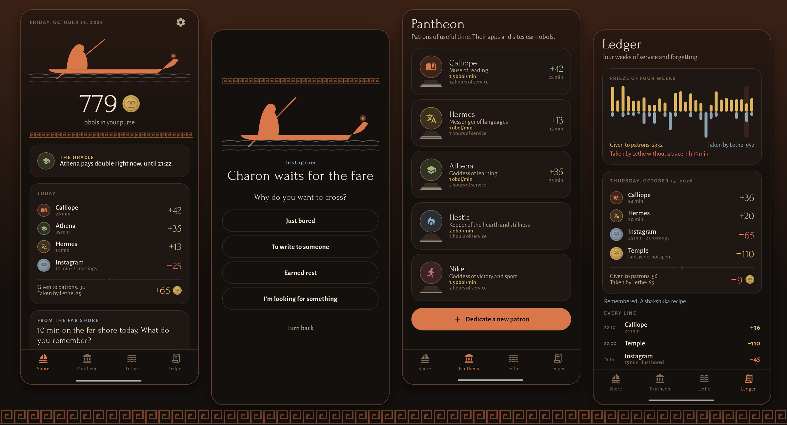
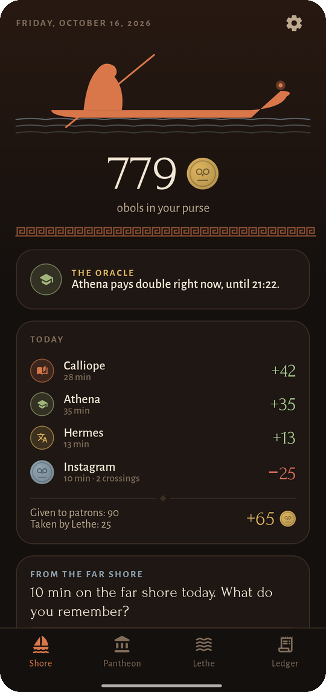
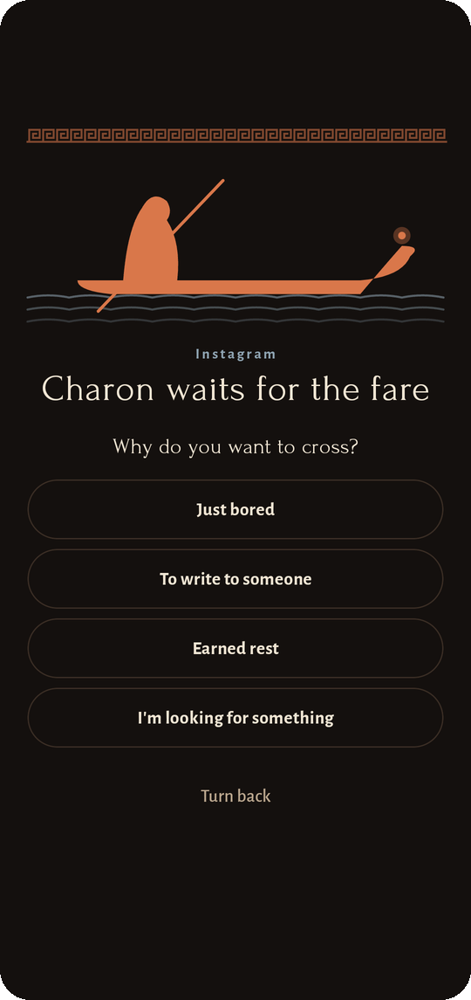
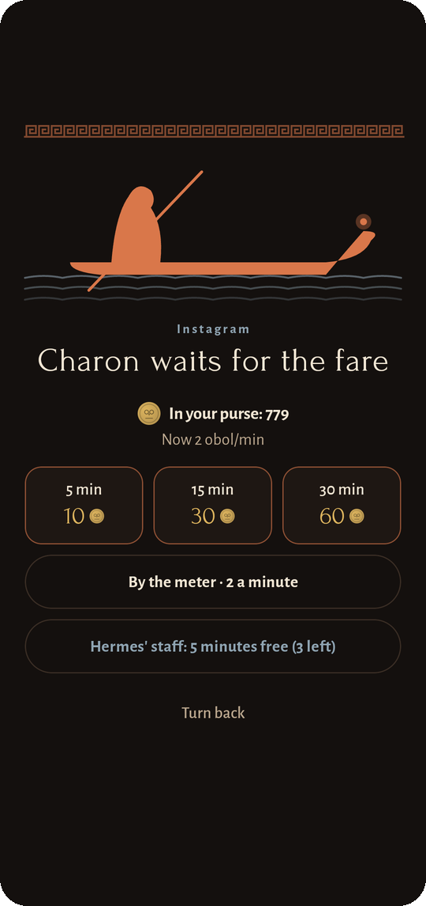
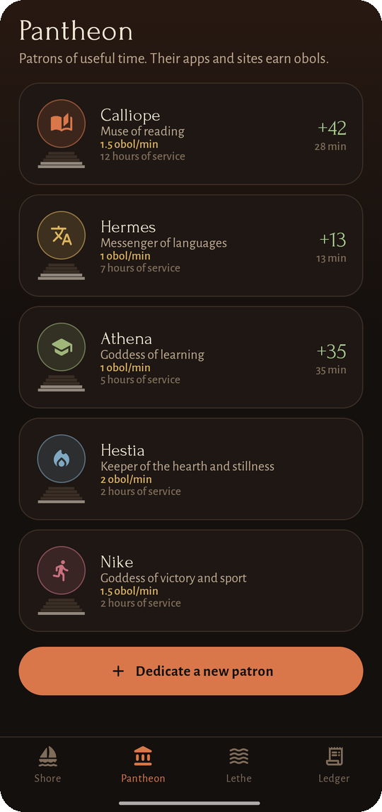
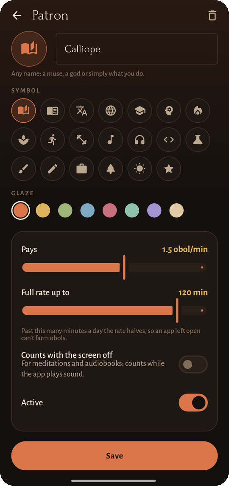
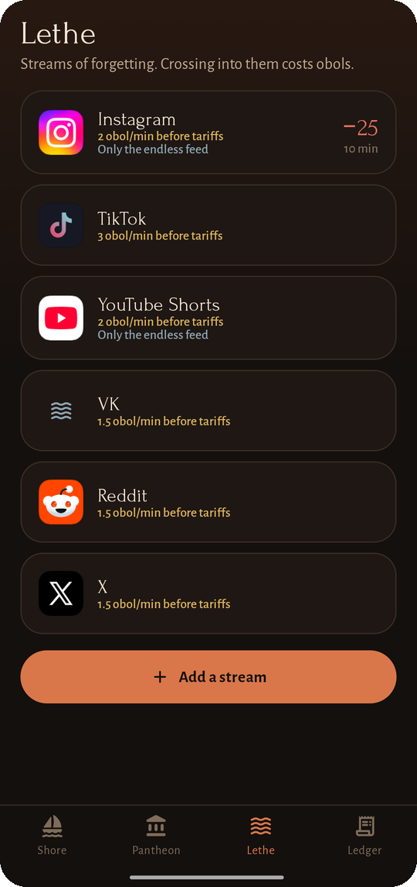
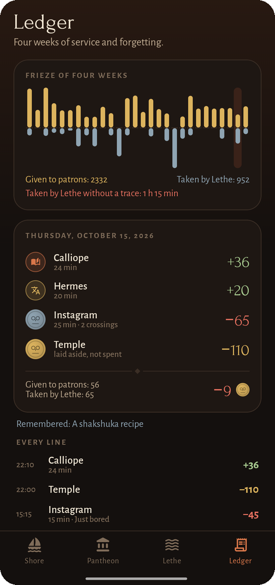
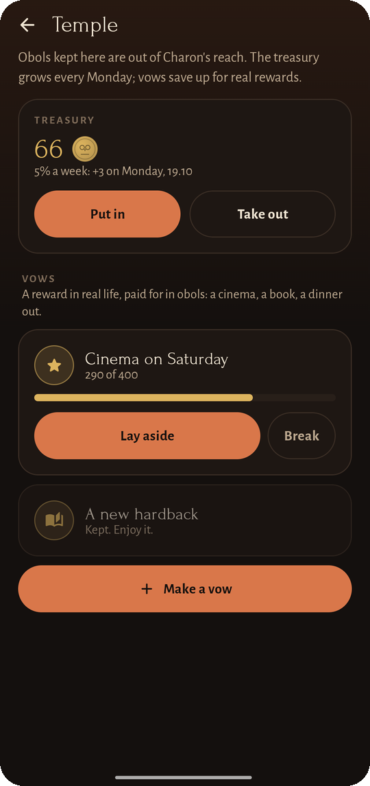
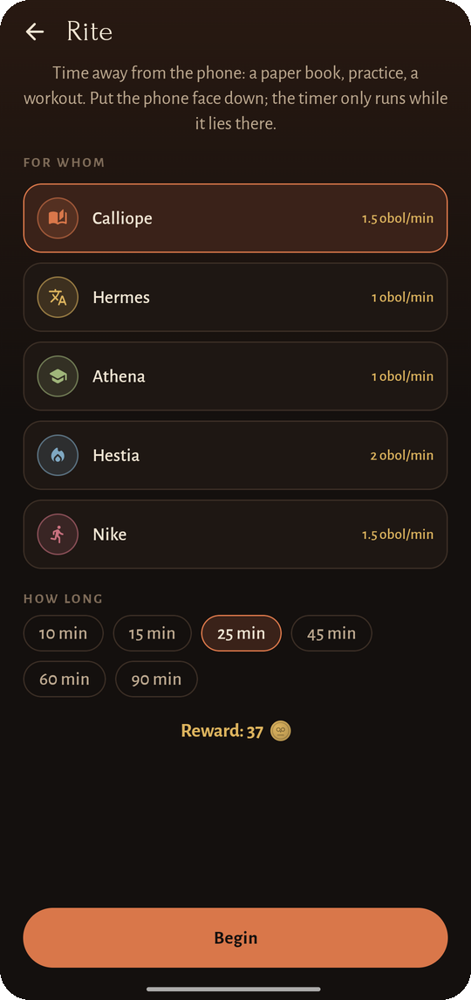

<div align="center">


# Obol

### Every crossing of Lethe costs an obol

*Books, languages, lessons and meditations earn obols. Reels, Shorts and TikTok cost them: Charon waits at the gate of every endless feed. No ads, no account, no internet access.*

[](https://github.com/bigdevwhale/obol/actions/workflows/android.yml)
[](https://github.com/bigdevwhale/obol/releases/latest)


[](LICENSE)

**English** · [Русский](README.ru.md) · [Website](https://bigdevwhale.github.io/stillcraft/apps/obol/) · [Changelog](CHANGELOG.md)



</div>

---

## The idea

In the Greek myth, Lethe is the river of forgetting, and Charon ferries souls across it for an obol. An endless feed is the same river: you drink from it, and an hour is gone without a trace.

Obol makes every crossing cost something and pays you for time spent on what matters. Serve the muses and gods of useful time to earn obols; spend them on the far shore when you choose to, not by reflex.

## What's inside

| | Feature | How it works |
|---|---|---|
| 🏛️ | **Pantheon** | Patrons of useful time: Calliope (reading), Hermes (languages), Athena (learning), Hestia (meditation), Nike (sport). Dedicate your own to anything (guitar, code, a side project) with a name, a symbol, a glaze, a rate, a daily cap, apps and sites. Patrons stand on pedestals that grow with the hours you give them, and crack when you forget them for a week. |
| 🌊 | **Lethe** | Streams that cost obols: Instagram, TikTok, YouTube Shorts, VK, Reddit, X, or anything you add, apps and sites alike (`youtube.com/shorts` works in browsers). **Only the endless feed** makes Reels and Shorts paid while messages and the rest of the app stay free. |
| ⛵ | **Charon's gate** | Opening a stream brings up the gate: why do you want to cross, a few breaths, then 5, 15 or 30 minutes, the meter, or a free pass from Hermes' staff. The reel underneath is paused. Turning back is always free. |
| ⏳ | **The plaque** | While you're on the far shore, a small plaque in the corner counts down the time you paid for, or shows the meter. |
| 🌙 | **Tariffs** | Nyx's hour (night ×3), the early morning ×2, and a fare that rises with every crossing after the first one today. |
| ⚖️ | **Debt to Hades** | An empty purse can go below zero, with interest on the borrowed part. |
| 🌫️ | **Mist of Lethe** | After five minutes on the far shore a grey haze creeps in from the edges of the screen, thickest after twenty-five. |
| 🔮 | **The oracle** | Each day one patron pays double for two hours, and the oracle tells you when. |
| 🏺 | **Temple** | A treasury out of Charon's reach that grows 5 % every Monday, and vows: real rewards (a cinema, a book) saved up for in obols. |
| 🕯️ | **Rites** | Time away from the phone (a paper book, practice, a workout) by a timer that only runs while the phone lies face down. |
| 📜 | **Ledger** | A potsherd for every day with the reasons you gave Charon, a four-week frieze, and an evening question: what do you remember from the far shore? Days with nothing count as taken by Lethe without a trace. |
| ⚔️ | **Oath by the Styx** | Swear for 1, 3, 7 or 30 days: tariffs and the gate lock, streams can only get dearer, and Obol becomes a device administrator, so removing it takes extra screens. Breaking the oath is possible, but it stays on record. |
| 💰 | **Widget** | The purse on the home screen with today's given and taken. |

<table>
  <tr>
    <td></td>
    <td></td>
    <td></td>
    <td></td>
    <td></td>
  </tr>
  <tr>
    <td></td>
    <td></td>
    <td></td>
    <td></td>
    <td></td>
  </tr>
</table>

## How it works

Charon is an accessibility service. Once a second it reads which app is in front, the address bar of common browsers (Chrome, Firefox, Samsung Internet, Yandex, Opera, Edge, Brave and others) and, for feed-only streams, the view ids that give away Reels or Shorts. Time counts for a patron only while you touch, scroll or type, or while a meditation plays with the screen off. Past a patron's daily cap the rate halves, so an app left open can't farm obols.

## Download

Get the APK from **[Releases](https://github.com/bigdevwhale/obol/releases/latest)**. Obol isn't on Google Play: install the APK, open it and switch Obol on in **Settings → Accessibility**. It needs Android 8.0 (API 26) or newer.

> [!TIP]
> On Xiaomi (MIUI / HyperOS), Huawei and some other phones, allow **Autostart** and remove battery limits, or the system will put Charon to sleep.
>
> Charon keeps a quiet notification, "Charon is on watch". Without it HyperOS freezes the app while a feed is open. You can hide the notification in the system settings; Charon keeps working.

## Privacy

Obol has no internet permission at all: no accounts, no servers, no analytics, no ads. It sees which app and site is open only to count time and draw the gate; nothing is stored beyond the ledger lines, and nothing leaves the phone.

## English & Русский

Every screen is written natively in both languages. Switch in **Settings → Language**.

## Under the hood

- **Kotlin + Jetpack Compose**, Material 3 with a black-figure palette (and a red-figure one by day), the Forum and Alegreya Sans typefaces. Charon's boat, the Greek key, the obols and the pedestals are drawn on a `Canvas`.
- **Room** keeps patrons, streams, their apps and sites, the ledger and crossings. The balance is the sum of the ledger; obols laid aside in the temple move into a `held` column and leave the purse without being spent.
- `domain/` holds the pure rules (tariffs, debt, earning with caps, site matching, the oracle) with unit tests.

```
app/src/main/java/app/obol/
├── data/        Room database, settings, presets, demo seed
├── domain/      tariffs, rules, bank, temple, oracle
├── watch/       Charon (accessibility service), the gate, the plaque, the mist, the oath
├── widget/      the purse on the home screen
└── ui/          shore, pantheon, Lethe, ledger, temple, rite, settings
```

Build it with `./gradlew assembleDebug`. `./gradlew installDebug -Pdemo` installs `app.obol.demo` with four weeks of made-up history, the one used for these screenshots.

## License

[MIT](LICENSE). Part of [Stillcraft](https://bigdevwhale.github.io/stillcraft/), small tools for a quieter mind.
