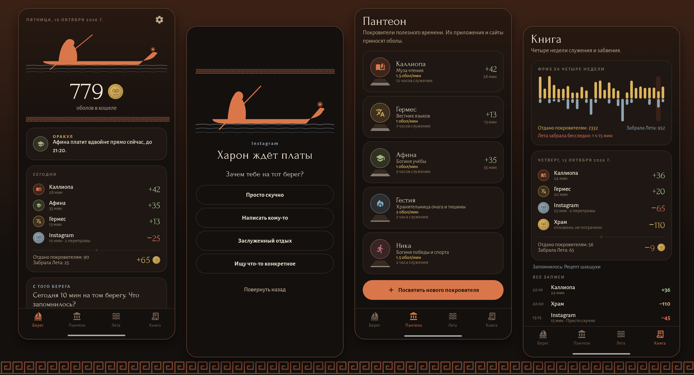
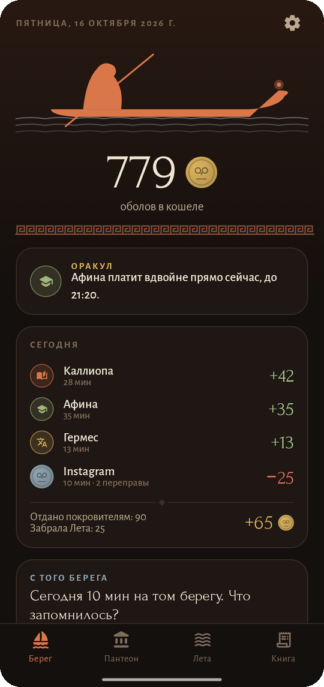
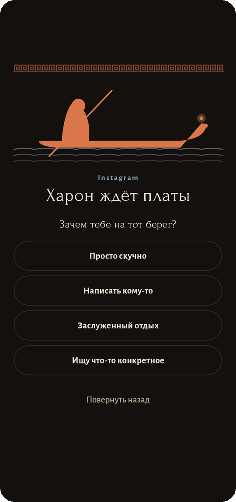
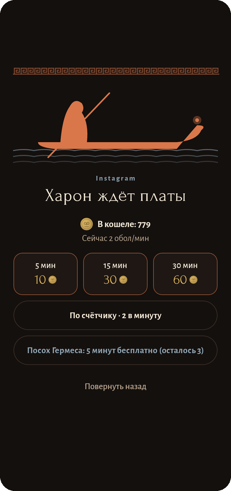
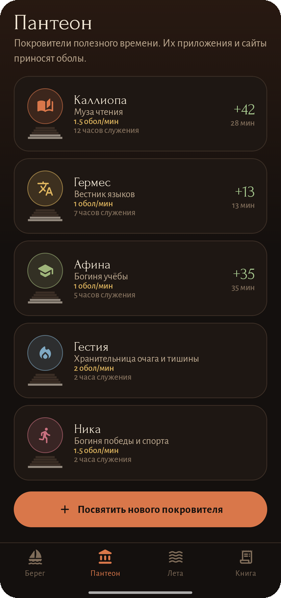
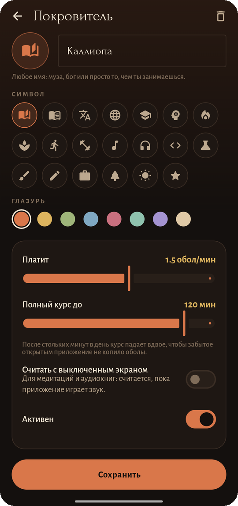
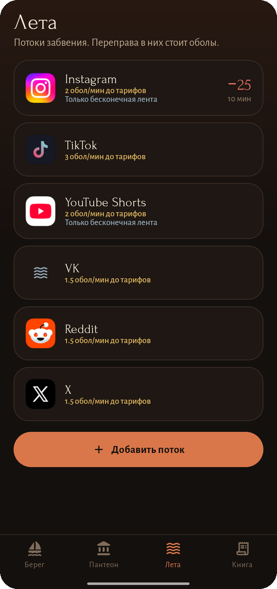
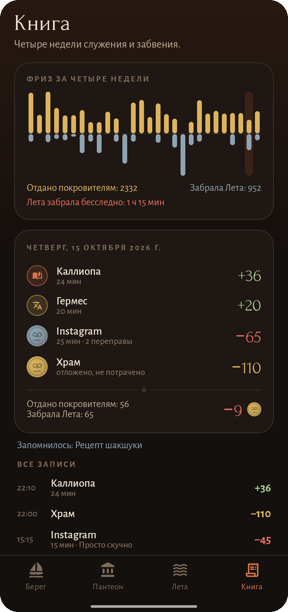
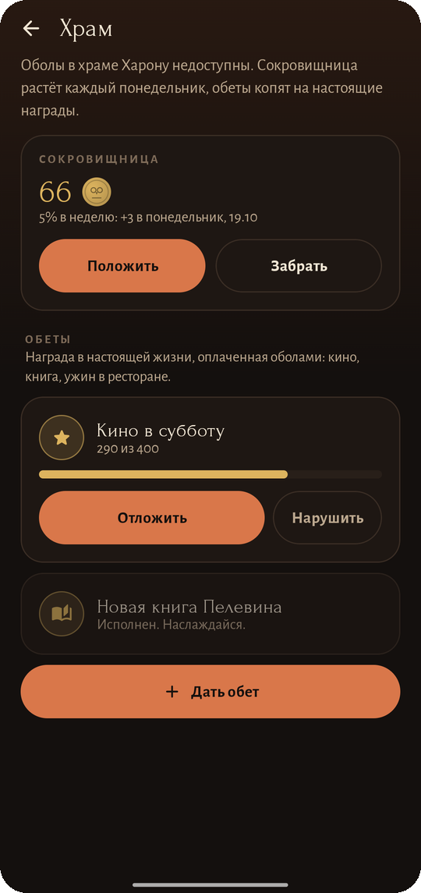
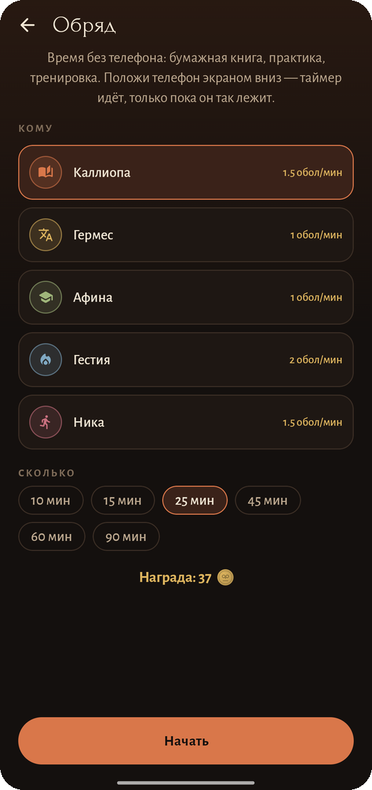

# Обол

### Каждая переправа через Лету стоит обол

*Книги, языки, уроки и медитации приносят оболы. Reels, Shorts и TikTok их тратят: у ворот каждой бесконечной ленты ждёт Харон. Без рекламы, без аккаунта, без доступа в интернет.*

[English](README.md) · **Русский** · [Сайт](https://bigdevwhale.github.io/stillcraft/apps/obol/) · [История изменений](CHANGELOG.md)

---

## Идея

В греческом мифе Лета — река забвения, а Харон перевозит через неё души за обол. Бесконечная лента — та же река: выпил из неё, и час исчез без следа.

Обол делает каждую переправу платной и платит тебе за время, проведённое с пользой. Служи музам и богам полезного времени — получай оболы. Трать их на том берегу, когда сам решил, а не по привычке.

## Что внутри

| | Возможность | Как это работает |
|---|---|---|
| 🏛️ | **Пантеон** | Покровители полезного времени: Каллиопа (чтение), Гермес (языки), Афина (учёба), Гестия (медитация), Ника (спорт). Посвяти своего чему угодно — гитаре, коду, своему проекту: имя, символ, глазурь, курс, дневной лимит, приложения и сайты. Покровители стоят на пьедесталах, которые растут с часами служения, и трескаются, если забыть о них на неделю. |
| 🌊 | **Лета** | Потоки, за которые платят: Instagram, TikTok, YouTube Shorts, VK, Reddit, X или что угодно своё — приложения и сайты (`youtube.com/shorts` работает в браузерах). **Только бесконечная лента** делает платными Reels и Shorts, а переписка и остальное приложение остаются бесплатными. |
| ⛵ | **Ворота Харона** | Открываешь поток — появляются ворота: зачем тебе на тот берег, несколько вдохов, затем 5, 15 или 30 минут, счётчик или бесплатный проход с посохом Гермеса. Ролик под воротами встаёт на паузу. Повернуть назад можно всегда и бесплатно. |
| ⏳ | **Остров** | Пока ты на том берегу, в уведомлении идёт обратный отсчёт. На Xiaomi он живёт в Super Island вокруг камеры, на Android 16 — чипом Live Update, на других телефонах — маленькой плашкой в углу. |
| 🌙 | **Тарифы** | Час Никты (ночью ×3), раннее утро ×2 и плата, растущая с каждой переправой после первой за день. |
| ⚖️ | **Долг Аиду** | Пустой кошель может уйти в минус, с процентами на занятую часть. |
| 🌫️ | **Туман Леты** | После пяти минут на том берегу с краёв экрана наползает серая дымка, гуще всего — после двадцати пяти. |
| 🔮 | **Оракул** | Каждый день один покровитель два часа платит вдвойне, и оракул скажет когда. |
| 🏺 | **Храм** | Сокровищница, недоступная Харону, растёт на 5 % каждый понедельник, а обеты копят оболы на настоящие награды: кино, книгу. |
| 🕯️ | **Обряды** | Время без телефона — бумажная книга, практика, тренировка — по таймеру, который идёт, только пока телефон лежит экраном вниз. |
| 📜 | **Книга** | Черепок на каждый день с причинами, названными Харону, фриз за четыре недели и вечерний вопрос: что запомнилось с того берега? Дни, когда ничего, Лета забрала бесследно. |
| ⚔️ | **Клятва Стиксом** | Поклянись на 1, 3, 7 или 30 дней: Обол нельзя удалить, тарифы и ворота заперты, потоки могут только дорожать. Нарушить клятву можно, но это останется в истории. |
| 💰 | **Виджет** | Кошель на главном экране и сколько сегодня отдано и забрано. |

<table>
  <tr>
    <td></td>
    <td></td>
    <td></td>
    <td></td>
    <td></td>
  </tr>
  <tr>
    <td></td>
    <td></td>
    <td></td>
    <td></td>
    <td></td>
  </tr>
</table>

## Как это работает

Харон — служба специальных возможностей. Раз в секунду он смотрит, какое приложение открыто, адресную строку популярных браузеров (Chrome, Firefox, Samsung Internet, Яндекс, Opera, Edge, Brave и других) и, для потоков «только лента», идентификаторы экранов, по которым видно Reels или Shorts. Время засчитывается покровителю, только пока ты касаешься экрана, листаешь или печатаешь, или пока медитация звучит с выключенным экраном. После дневного лимита курс падает вдвое, так что забытое открытым приложение оболов не накопит.

## Скачать

APK лежит в **[релизах](https://github.com/bigdevwhale/obol/releases/latest)**. В Google Play Обола нет: установи APK, открой его и включи Обол в **Настройки → Специальные возможности**. Нужен Android 8.0 (API 26) или новее.

> [!TIP]
> На Xiaomi (MIUI / HyperOS), Huawei и некоторых других телефонах разреши **автозапуск** и сними ограничения батареи, иначе система усыпит Харона.

## Приватность

У Обола вообще нет разрешения на интернет: ни аккаунтов, ни серверов, ни аналитики, ни рекламы. Он видит открытое приложение и сайт только чтобы считать время и ставить ворота; хранятся лишь строки книги, и ничего не покидает телефон.

## English & Русский

Каждый экран написан на обоих языках. Переключение — в **Настройки → Язык**.

## Как устроено

- **Kotlin + Jetpack Compose**, Material 3 с чернофигурной палитрой (и краснофигурной для дня), шрифты Forum и Alegreya Sans. Лодка Харона, меандр, оболы и пьедесталы нарисованы на `Canvas`.
- **Room** хранит покровителей, потоки, их приложения и сайты, книгу и переправы. Баланс — сумма книги; оболы, отложенные в храм, уходят в колонку `held` и покидают кошель, не будучи потраченными.
- В `domain/` — чистые правила (тарифы, долг, заработок с лимитами, сопоставление сайтов, оракул) с юнит-тестами.

Собрать: `./gradlew assembleDebug`. `./gradlew installDebug -Pdemo` ставит `app.obol.demo` с четырьмя неделями выдуманной истории — с неё сняты эти скриншоты.

## Лицензия

[MIT](LICENSE). Часть [Stillcraft](https://bigdevwhale.github.io/stillcraft/) — маленьких инструментов для спокойного ума.
